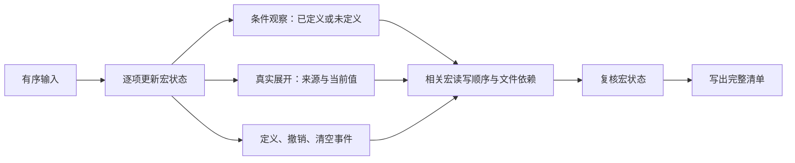

# 宏状态与文件顺序

条件宏探测读取当前位置的状态，允许得到未定义；真实宏展开读取宏内容，需要保留定义来源。实线表示数据流，排序结果必须通过宏状态复核才能写出清单。

## 输入时间线

前导文件中的源码和宏选项按条目顺序执行。前导结束后，按顶层请求顺序处理源码，并继续处理发现的依赖；同一源码只处理一次。include 在出现的位置展开，其宏变化归属宿主源码。

`source` 指定检索范围，不代表编译清单。目录扫描的文件名排序不能替代宏输入顺序。

## 条件探测

`ifdef`、`ifndef`、`elsif` 只检查当前宏是否存在。未定义的宏不需要查找定义文件；后面出现一个或多个同名定义，也不会使前面的条件产生来源歧义。

只记录实际被判断的条件。外层分支未进入，或前面的条件已经选中分支时，后续未执行的条件不产生观察记录。

## 宏读写顺序

同一个宏的前次写入、观察或真实读取、后次写入构成顺序关系。撤销操作也会改变状态；清空操作结束此前所有宏的状态，并开始新的状态阶段。

| 输入中的相关事件 | 读取结果 | 排序要求 |
| --- | --- | --- |
| 探测 FLAG，随后定义 FLAG | 未定义 | 探测文件保留在后续定义之前 |
| 定义 FLAG，随后探测 FLAG | 已定义 | 探测保留在实际前置定义之后 |
| 定义 FLAG，撤销 FLAG，随后探测 | 未定义 | 撤销操作保持在定义与探测之间 |
| 定义 WIDTH 为 8，读取 WIDTH，重定义为 16 | 8 | 真实读取保持在两次定义之间 |
| 定义 OTHER，同时探测 OPTIONAL | OPTIONAL 的原状态 | 两个不同宏不产生额外顺序要求 |

真实宏读取继续使用输入位置上已知的来源。没有已知来源时，只能对已选源码中的唯一实际提供者建立前置要求；这条规则不适用于条件探测。

## 文件依赖与冲突

package 必须位于使用它的文件之前，前导源码保持固定顺序。普通模块可以前向引用；其文件前置偏好与宏状态顺序相反时，可以放宽模块顺序，保持选中的分支和宏读取结果。

顶层文件的位置由这些顺序要求共同决定，不保证处于清单最后。

如果包前置、固定前导顺序与宏状态不能同时满足，程序报告相关文件和宏，不覆盖旧清单。原有模块循环也继续报错。

## 缓存与输出

每个文件的入口宏环境参与缓存有效性判断。缓存保留真实读取、条件观察和活动写入事件；缓存复用也按本轮输入位置重放事件，不能复用上一次的全局宏状态。

排序结束后，按实际输出时间线复核条件状态及必要宏的可用性。成功完成依赖收集、排序与复核后，清单才会替换已有输出。

## 语言范围

这是依赖分析器，不提供完整宏展开、参数计算或编译器名称绑定。跨文件宏按共享编译单元处理；独立编译器验证需要选择相同的编译单元模式。具体编译工具的全局命令行宏处理方式应按该工具设置。

参考：[slang 预处理](https://www.sv-lang.com/parsing.html)、[slang 编译单元](https://sv-lang.com/user-manual.html)、[Verific 宏可见性](https://www.verific.com/faq/index.php?title=Defined_macros_become_undefined_-_MFCU_vs_SFCU)。
